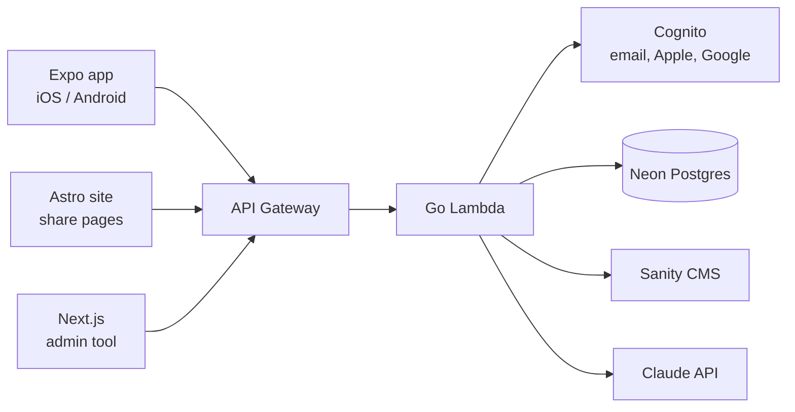

### Hi, I'm Steven 👋

Full-stack engineer with 10+ years shipping production software, from the Paramount+ streaming app on smart TVs and game consoles to a mobile app I built and launched as a solo founding engineer.

Currently founding engineer at **Scraftable**. Open to senior full-stack and front-end IC roles.

---

### 📱 Pocket Personality

An MBTI personality test app, live on the [App Store](https://apps.apple.com/us/app/pocket-personality/id6783556333) and [Google Play](https://play.google.com/store/apps/details?id=com.scraftable.pocketpersonality). Website: [pocketpersonality.com](https://pocketpersonality.com)

I built every part of it: the mobile app, backend, infrastructure, admin tooling, and marketing site.

- **Offline-first mobile app** in React Native/Expo with SQLite, so tests, scoring, and results work with no network.
- **Go Lambda backend** behind API Gateway, with ~115ms median cold-start init (p95 under 130ms, measured in production).
- **Infrastructure as code** in SAM/CloudFormation, with separate dev, preview, and prod stacks, each with its own Cognito pool and database.
- **Shareable result links**: a Postgres advisory lock enforces one active link per profile, with timezone-aware expiry, Universal Links / App Links, and a static Astro share page.
- **LLM features**: Claude generates personalized insights and rewrites shared reports in the third person, with caching and a graceful fallback.
- **Quality**: GitHub Actions CI, Maestro end-to-end tests on release builds, and golden-vector tests that keep scoring identical across three engines.

The source is private, but I'm happy to walk through the code and architecture in an interview.

**Open source:** contributor to [react-component-caching](https://github.com/rookLab/react-component-caching) (388★), component-level caching for faster React server-side rendering.

---

### 🛠 Stack

**Languages:** TypeScript, JavaScript, Go, SQL 
**Frontend & mobile:** React, React Native, Expo, Next.js, Astro, Redux, Tailwind CSS 
**Backend & cloud:** AWS (Lambda, API Gateway, Cognito, SAM), PostgreSQL, Node.js, Sanity, Vercel 
**Testing & tooling:** Jest, React Testing Library, Maestro, GitHub Actions, Sentry, PostHog 
**AI:** Claude API / LLM integration, Claude Code

---

### 📫 Contact

[LinkedIn](https://www.linkedin.com/in/steven-lee-9727a210/) · [steven-lee.com](https://steven-lee.com) · info@steven-lee.com
